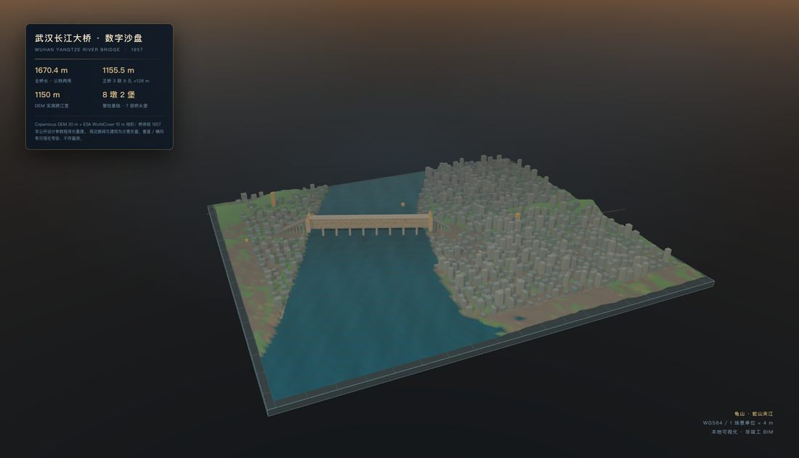
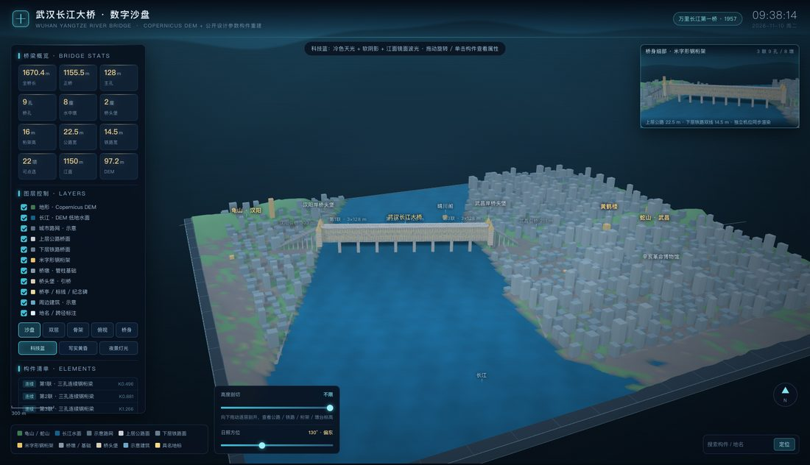
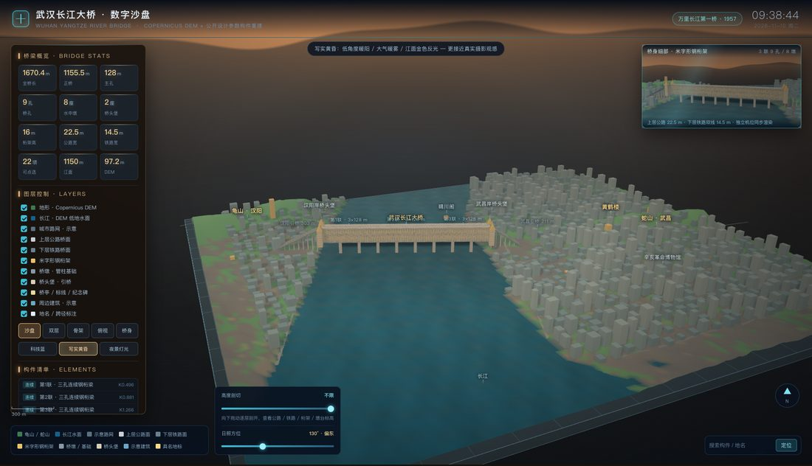
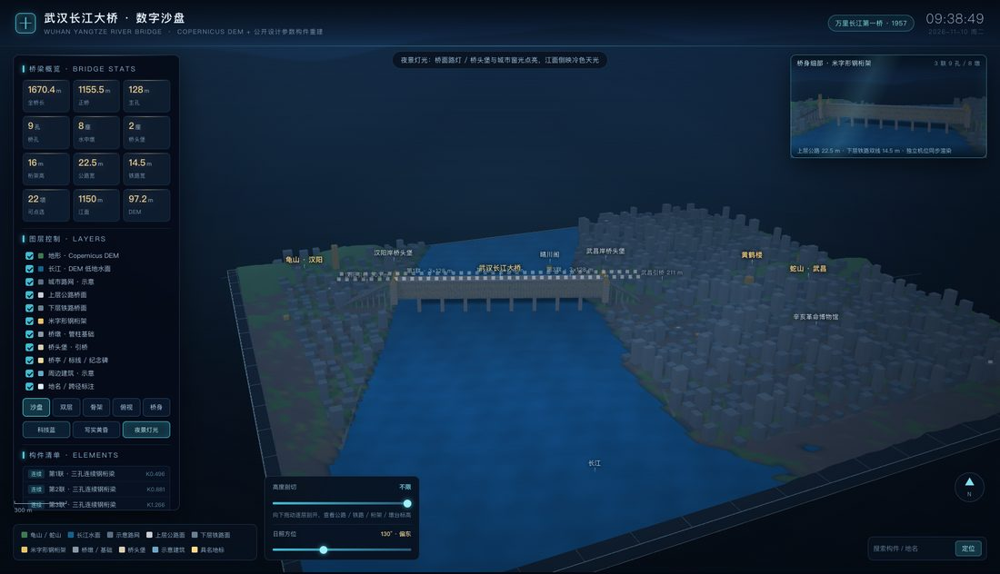
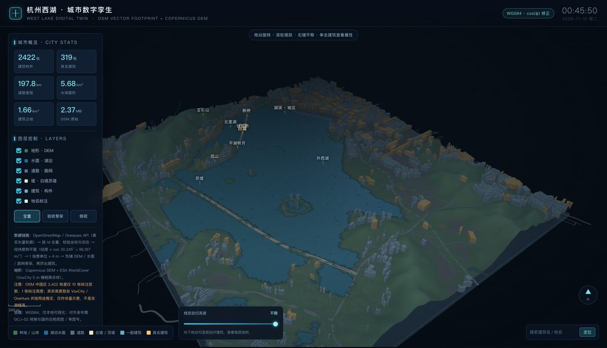
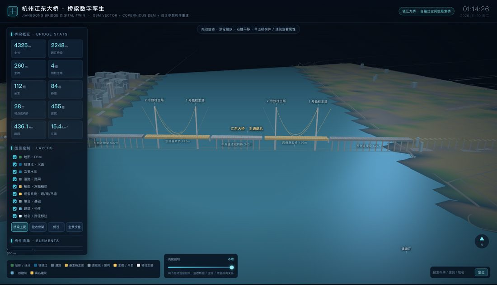
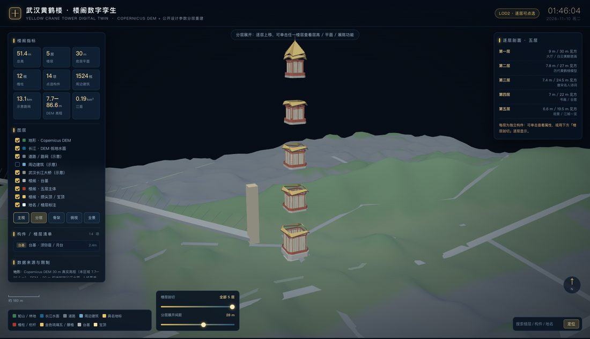
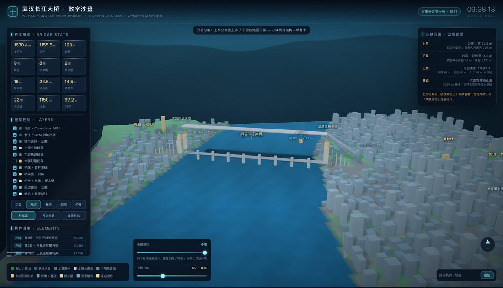

# digital-twin-studio

把一个**真实地点**做成双击即可打开、断网可用的**单文件 three.js 数字孪生大屏 / 数字沙盘**。

- 真实底座：Copernicus DEM 30 m 地形 + ESA WorldCover 10 m 地表 + Overpass / OSM 矢量；
  OSM 不可达时自动降级为**示意矢量**并在页面、数据、文档三处标注，绝不冒充实测。
- 主角重建：城区体块 / 桥梁构件 / 楼阁逐层 / 公铁两用桁架桥，构件可点选、可剖切、可分解。
- 大屏交互：指标、图层、模式机位、逐层或逐高剖切、属性面板、搜索定位、网格底座、画中画细部。
- 可选写实质感：PBR 软阴影、渐变天空与远山剪影、自定义水面着色器（菲涅尔 / 桥影 / 波光）、
  科技蓝 / 写实黄昏 / 夜景灯光三档氛围、日照方位滑块、夜景灯点、无 UI 纯净沙盘出图。
- 全流程自带无头 Chromium 出图与冒烟校验，JS 异常 / DOM 初始化 / 点选都能自动验。

这是 WorkBuddy 的 Skill，也可以当纯脚本库用。

## 效果展示

下面全部由本仓库脚本生成、再由无头 Chromium 对**单文件 HTML** 直接截图，没有后期合成。
材质、天空、水面波纹、投影桥影与灯点属于**表达性渲染，不作量测**；
武汉案例周边路网 / 建筑为 OSM 不可达时的示意矢量（页面中已标注）。

### 数字沙盘 · 写实黄昏



*Copernicus DEM 地形 + 江面 + 公铁两用桁架桥；无 UI 纯净图带信息展板，可直接用于汇报。*

### 同一场景 · 三档光影氛围

<table>
  <tr>
    <td align="center" width="33%"><br><b>科技蓝</b><br><sub>冷色天光 · 软阴影 · 江面镜面波光</sub></td>
    <td align="center" width="33%"><br><b>写实黄昏</b><br><sub>低角度暖阳 · 大气暖雾 · 金色反光</sub></td>
    <td align="center" width="33%"><br><b>夜景灯光</b><br><sub>桥面路灯 · 城市窗光 · 冷色天光倒影</sub></td>
  </tr>
</table>

*「日照方位」滑块会让日轮、江面高光与桥影一起移动；右上角是同一场景独立机位的桥身细部画中画。*

### 四个交付案例

<table>
  <tr>
    <td align="center" width="50%"><br><b>杭州西湖 · 城区矢量孪生</b><br><sub>真实 OSM：2,422 栋建筑 / 197.8 km 路网</sub></td>
    <td align="center" width="50%"><br><b>杭州江东大桥 · 悬索桥构件</b><br><sub>4 塔 / 8 主缆 / 112 吊索 / 28 可点选构件</sub></td>
  </tr>
  <tr>
    <td align="center" width="50%"><br><b>武汉黄鹤楼 · 逐层剖切</b><br><sub>五层独立 mesh，逐层剖切与爆炸展开</sub></td>
    <td align="center" width="50%"><br><b>武汉长江大桥 · 双层分解</b><br><sub>上层公路 / 下层铁路与结构说明卡片</sub></td>
  </tr>
</table>

## 安装

```bash
# 作为 WorkBuddy 技能安装
git clone git@github.com:alinkiot/digital-twin-studio.git \
    ~/.workbuddy/skills/digital-twin-studio

# 或者放到本机技能工作区再做软链
git clone git@github.com:alinkiot/digital-twin-studio.git \
    ~/MyProject/skills/digital-twin-studio
ln -s ~/MyProject/skills/digital-twin-studio ~/.workbuddy/skills/digital-twin-studio
```

`SKILL.md` 是技能入口（触发条件、工作流、硬约束）；`references/` 是细节文档；
`scripts/` 与 `assets/templates/` 可直接单独调用，不装技能也能用。

## 目录

```
SKILL.md                        技能说明与工作流（含 7 步：确定范围 → 取数 → 组装 → 出 HTML → 验证 → 可选质感增强）
scripts/
  twin_common.py                坐标换算、DEM → 地形/水面、OSM 解析、示意矢量降级
  fetch_raster.py               Copernicus DEM + ESA WorldCover 下载
  fetch_osm.py                  Overpass 多镜像探测（退出码 2 = 降级）
  make_scene.py                 组装标准 scene_data.json
  render_views.py               批量无头截图 + JS 异常检查
  smoke_check.py                DOM / 交互冒烟（11 项）
  visual_fx.py                  可选写实质感增强片段库（TwinFX.install）
  validate_skill.py             仓库自检（Python 编译 / JS 语法 / 资源完整性）
references/
  pipeline.md                   数据契约、渲染分层、改常量清单
  data_sources.md               数据源、镜像实测、坐标系与合规
  visual_fx.md                  写实质感配方、shader 关键段、参数表、收敛记录
  pitfalls.md                   全部踩坑与修复
  cases.md                      四个已交付案例的参数与产物
assets/
  lib/three.min.js              内联用 three.js r15x（MIT，文件头保留 SPDX 许可）
  templates/city/               西湖：面状城区 / 水系 / 路网
  templates/bridge/             江东大桥：悬索桥构件
  templates/tower/              黄鹤楼：楼阁逐层
  templates/sandbox/            武汉长江大桥：数字沙盘 + 写实质感增强（含改常量清单）
docs/images/                   README 效果图（8 张，由无头截图压缩，共约 0.5 MB）
```

## 快速开始

```bash
S=~/MyProject/skills/digital-twin-studio
PY=~/MyProject/tmp/voxcity-env/bin/python     # numpy + rasterio
W=~/MyProject/tmp/voxcity/tower              # 产物在 W/../out

$PY $S/scripts/fetch_raster.py --bbox 114.286,30.537,114.309,30.554 --out $W/raster
$PY $S/scripts/fetch_osm.py    --bbox 114.286,30.537,114.309,30.554 --out $W/osm.json
# 退出码 2 时下一步不要带 --osm，走示意矢量降级
$PY $S/scripts/make_scene.py   --bbox 114.286,30.537,114.309,30.554 \
    --dem $W/raster/dem.tif --osm $W/osm.json --subject tower \
    --subject-xy 114.2966,30.5453 --out $W/scene_data.json

cp -r $S/assets/templates/tower/*.py $W/ && cp $S/assets/lib/three.min.js $W/
$PY $W/build_tower.py && python3 $W/make_tower_html.py
$PY $S/scripts/render_views.py --html $W/../out/黄鹤楼_数字孪生.html \
    --out $W/../out --prefix 黄鹤楼 --modes main,floors,cut,skel,top,wide,pick
$PY $S/scripts/smoke_check.py --html $W/../out/黄鹤楼_数字孪生.html
```

需要「像效果图」时，按 `references/visual_fx.md` 增加第 7 步；最省事的做法是
`from visual_fx import inline_fx`，把返回的 CSS / JS 内联进 HTML 后调用
`TwinFX.install({THREE, scene, camera, renderer, waterMesh})`。

提交前自检：

```bash
python3 scripts/validate_skill.py
```

## 已交付案例

| 案例 | 主角 | 矢量 | 关键产物 |
| --- | --- | --- | --- |
| 杭州西湖 | 面状城区 / 水系 / 白堤 | 真实 OSM（4,106 要素、2,422 栋建筑、197.8 km 路网） | 体素模型、白堤系列图、矢量孪生大屏 |
| 杭州江东大桥 | 悬索桥构件 | 真实 OSM | 28 个可点选构件、4 塔 8 缆 112 吊索 |
| 武汉黄鹤楼 | 楼阁逐层 | 示意（OSM 不可达） | 五层独立 mesh、逐层剖切与爆炸展开 |
| 武汉长江大桥 | 公铁两用桁架桥 | 示意（OSM 不可达） | 22 构件、双层分解、双视口画中画、三档光影、纯净沙盘图 |

## 依赖

- Python 3 + `numpy` / `rasterio`（取数与场景组装）；生成 HTML 的脚本只用标准库。
- Playwright 的 Chromium 或本机 Chrome（无头出图 / 冒烟）。
- `node`（可选，仅用于 JS 语法自检）。
- VoxCity 源码：标准流程不强制；`fetch_raster.py` 的轻量路径已内置，
  sandbox 模板的 WorldCover 颜色表也已内联。

## 数据与合规

- 产出是可视化 **LOD1 / LOD2**，不是竣工 BIM / IFC，也不是 Scan-to-BIM，不能用于结构分析或量测。
- 垂直 `ZEX`、主角放大 `TVIS` / `WVIS`、地形压缩、水面波纹、投影桥影、灯点均为
  **表达性渲染**，页面与说明文档必须写明「不作量测」。
- 数据源各自遵守 Copernicus DEM、ESA WorldCover、OpenStreetMap / ODbL 的条款。
- **对外发布前**必须做 WGS84 → GCJ-02 转换、使用国内合规底图并取得审图号。
- 内联的 `assets/lib/three.min.js` 为 three.js r15x，保持其原 MIT 许可（文件头含 SPDX 标识）。
